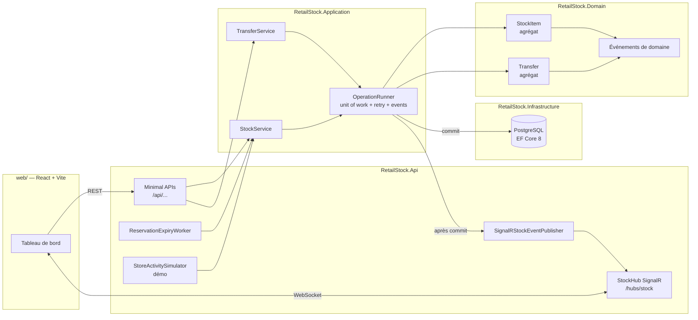
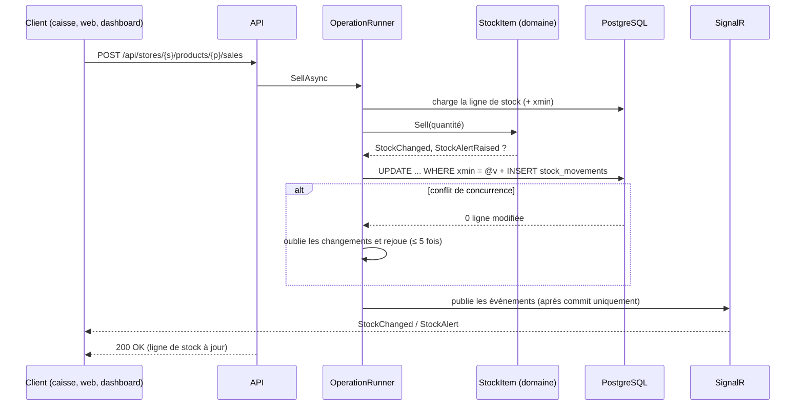

# RetailStock — Gestion des stocks multi-magasins en temps réel

[](https://github.com/KarnasZiad/RetailStock/actions/workflows/ci.yml)


RetailStock est une API **.NET 8** en **Clean Architecture** qui gère le stock d'un réseau de magasins.
Chaque mouvement (réception, vente en caisse, réservation click & collect, inventaire, transfert entre
magasins) est validé par le domaine, journalisé, puis **poussé en temps réel via SignalR** vers un
tableau de bord **React**.

> Le stock en temps réel est le cœur d'un système retail : un produit vendu en caisse à Lyon
> doit disparaître immédiatement du stock disponible pour le click & collect, et une rupture
> doit déclencher une alerte avant que le client ne la constate.

## Fonctionnalités

| Domaine | Ce qui est géré |
|---|---|
| **Stock par magasin** | Quantité en stock, quantité réservée, **disponible = stock − réservé**, seuil d'alerte par ligne |
| **Mouvements** | Réception, vente, ajustement d'inventaire, réservation, retrait client, annulation, expiration — chaque mouvement est écrit dans un **journal immuable** (`stock_movements`) |
| **Réservations** | Click & collect / e-réservation avec durée de vie ; un worker libère automatiquement les réservations expirées |
| **Transferts inter-magasins** | Expédition (le stock quitte la source) → réception à destination, ou annulation (retour à la source) |
| **Alertes de rupture** | Événements `StockAlertRaised` (stock bas / rupture) et `StockAlertCleared`, poussés en temps réel |
| **Tableau de bord** | Matrice produits × magasins, flux des mouvements en direct, alertes avec suggestion de rééquilibrage, transferts |

### Règles métier garanties

- **Pas de stock négatif** : ni en stock, ni en réservé, et le réservé ne dépasse jamais le stock (invariant de l'agrégat `StockItem`, doublé d'une contrainte `CHECK` en base).
- Une vente, un transfert ou une réservation ne consomme que le **disponible** (une unité réservée pour un client ne peut pas être vendue en caisse).
- Une réservation expirée ne peut plus être retirée ; une réservation clôturée ne peut être ni confirmée ni annulée une seconde fois.
- Un inventaire ne peut pas descendre sous la quantité réservée.
- Un transfert relie deux magasins distincts et ne peut être réceptionné ou annulé qu'une fois.
- **Concurrence** : verrouillage optimiste sur la colonne système PostgreSQL `xmin`, avec rejeu automatique de l'opération. Un test d'intégration lance 25 réservations simultanées sur 5 unités : exactement 5 réussissent, jamais de survente.

## Architecture



Les dépendances pointent vers le domaine : `Api → Application → Domain`, `Infrastructure → Application`.
Le domaine ne connaît ni EF Core ni ASP.NET.

### Déroulé d'une opération d'écriture



## Stack technique

- **Back** : .NET 8, ASP.NET Core Minimal APIs, EF Core 8, Npgsql, PostgreSQL 16, SignalR, Swagger (Swashbuckle), ProblemDetails (RFC 7807), health checks
- **Front** : React 18, TypeScript, Vite, `@microsoft/signalr`
- **Tests** : xUnit, `FakeTimeProvider`, Testcontainers (PostgreSQL), `WebApplicationFactory`, client SignalR
- **Ops** : Docker multi-stage, Docker Compose, GitHub Actions, gestion centralisée des packages NuGet

## Démarrer

### Tout en Docker

```bash
docker compose up --build
```

| Service | URL |
|---|---|
| Tableau de bord | http://localhost:8080 |
| API + Swagger | http://localhost:5080/swagger |
| PostgreSQL | `localhost:5432` (retailstock / retailstock) |

Au premier démarrage, l'API applique les migrations, crée un réseau de démonstration (5 magasins, 10 produits)
et active un **simulateur d'activité** (ventes, réservations web, réassorts) pour voir le temps réel en action.

### En développement

```bash
docker compose up -d postgres
dotnet run --project src/RetailStock.Api        # http://localhost:5080
cd web && npm install && npm run dev            # http://localhost:5173 (proxy vers l'API)
```

## API

| Méthode | Route | Rôle |
|---|---|---|
| GET | `/api/stores`, `/api/products` | Référentiel |
| GET | `/api/stock?storeId=&productId=` | État du stock |
| GET | `/api/stock/alerts` | Lignes en stock bas ou en rupture |
| GET | `/api/movements?storeId=&productId=&take=` | Journal des mouvements |
| POST | `/api/stores/{storeId}/products/{productId}/receipts` | Réception |
| POST | `/api/stores/{storeId}/products/{productId}/sales` | Vente |
| POST | `/api/stores/{storeId}/products/{productId}/adjustments` | Inventaire |
| POST | `/api/stores/{storeId}/products/{productId}/reservations` | Réservation |
| POST | `/api/reservations/{id}/confirm` · `/release` | Retrait client · annulation |
| GET/POST | `/api/transfers` | Liste · expédition d'un transfert |
| POST | `/api/transfers/{id}/receive` · `/cancel` | Réception · annulation |
| WS | `/hubs/stock` | `SubscribeAll()`, `SubscribeStore(id)` → `StockChanged`, `StockAlert`, `TransferUpdated` |
| GET | `/health` | Santé (PostgreSQL) |

Les erreurs métier renvoient un `422` au format ProblemDetails, avec un code stable :

```json
{
  "status": 422,
  "title": "Business rule violated",
  "detail": "Insufficient stock: 3 requested but only 2 available.",
  "code": "stock.insufficient"
}
```

## Tests

```bash
dotnet test                                   # tout (Docker requis pour les tests d'intégration)
dotnet test tests/RetailStock.UnitTests       # règles métier uniquement
```

- **Tests unitaires** (`RetailStock.UnitTests`) : invariants de `StockItem` et `Transfer` (stock négatif, réservations, expiration, seuils d'alerte, transferts), et cas d'usage avec des doublures en mémoire : écriture du journal, publication des événements **après** le commit seulement, rien n'est commité si une règle est violée.
- **Tests d'intégration** (`RetailStock.IntegrationTests`) : l'API réelle sur un PostgreSQL éphémère lancé par **Testcontainers** : vraies migrations, vraies requêtes SQL, concurrence réelle (25 réservations parallèles), cycle de vie click & collect, transferts, et réception des messages **SignalR** par un client connecté au hub.

## Structure

```
src/
  RetailStock.Domain/          Agrégats StockItem et Transfer, réservations, événements, règles
  RetailStock.Application/     Cas d'usage, OperationRunner (unit of work, retry, events), ports
  RetailStock.Infrastructure/  EF Core + PostgreSQL : DbContext, mappings, migrations, requêtes
  RetailStock.Api/             Minimal APIs, hub SignalR, gestion d'erreurs, workers
tests/
  RetailStock.UnitTests/       xUnit, domaine et application
  RetailStock.IntegrationTests/ xUnit, Testcontainers, WebApplicationFactory, SignalR
web/                           Tableau de bord React
```

## Pistes d'évolution

- Outbox transactionnelle pour publier les événements vers un bus (RabbitMQ/Kafka) vers les autres systèmes (e-commerce, ERP)
- Authentification (rôle siège / responsable de magasin) et filtrage SignalR par magasin côté serveur
- Prévision de rupture à partir du rythme de vente
